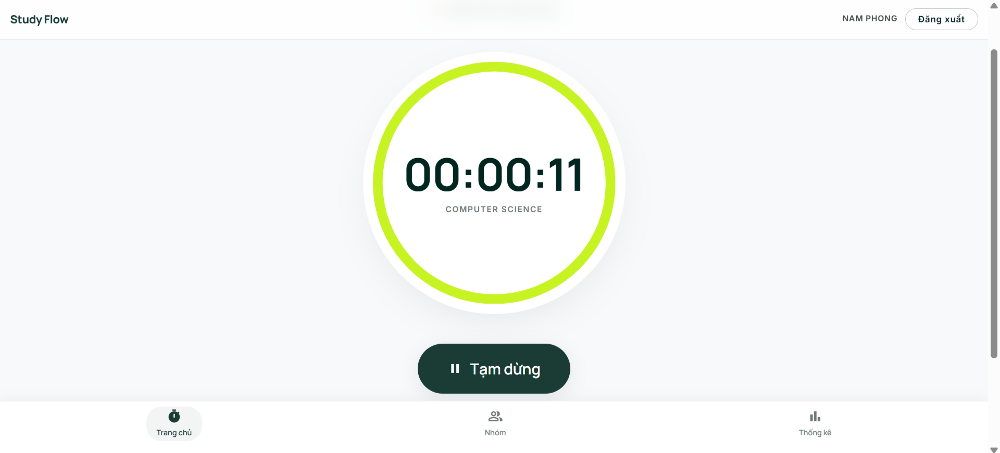
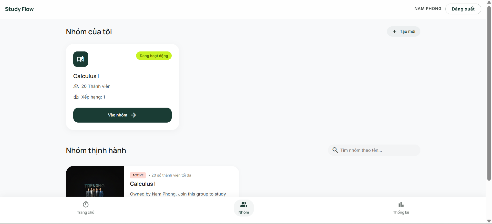
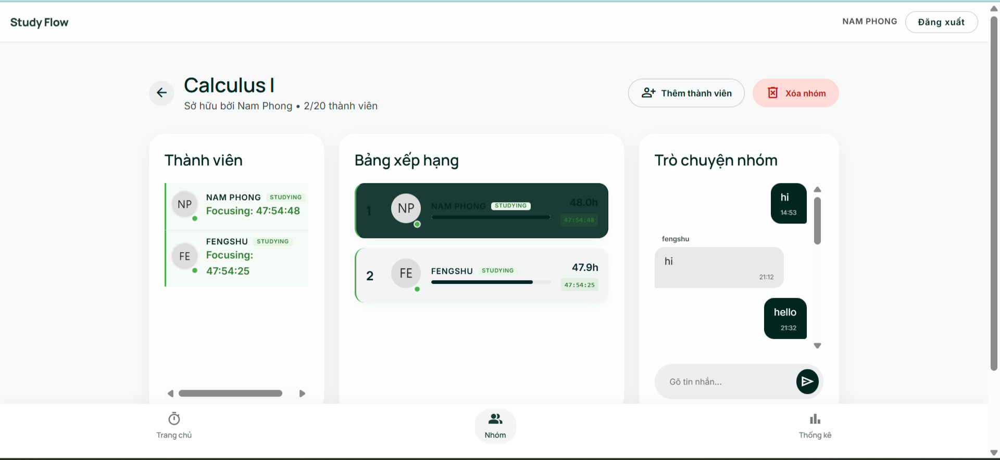
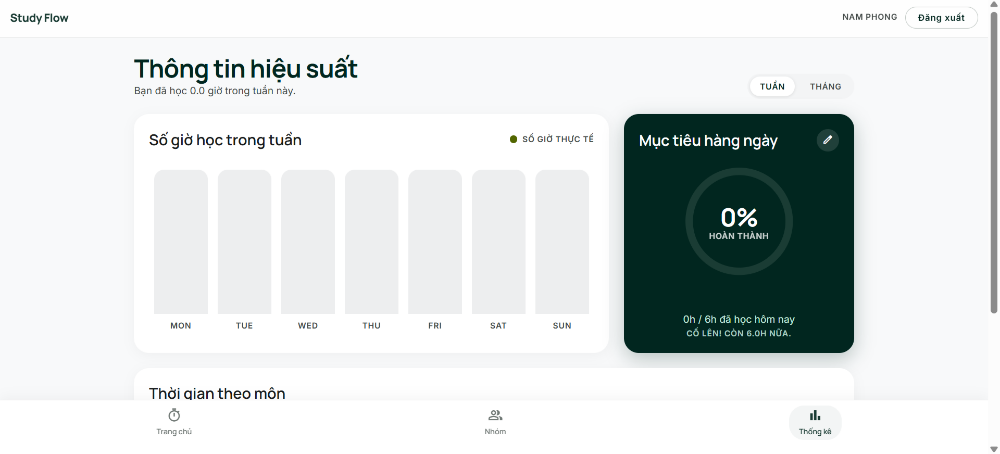
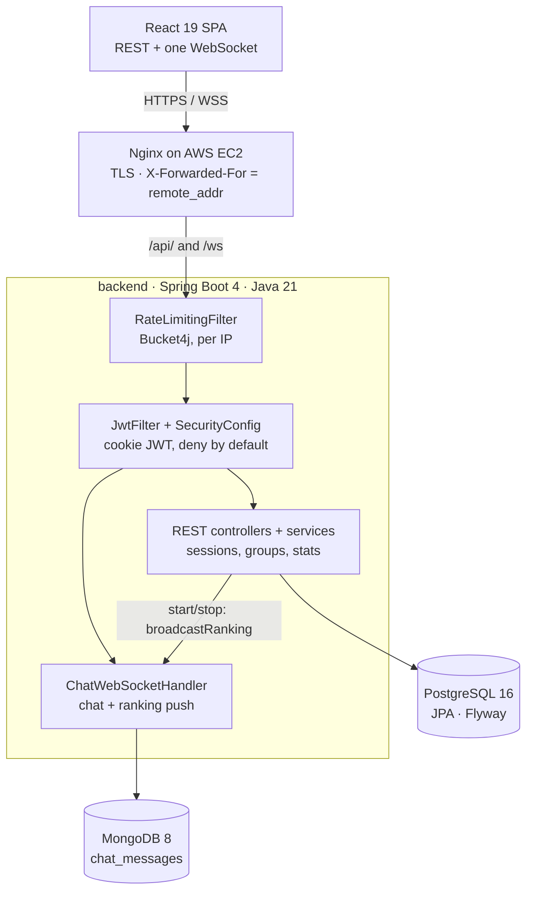
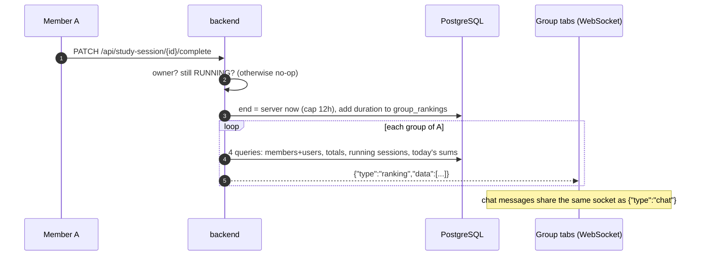

# Study App: focus together, rank together

A group study app. Each member runs a focus timer, the whole group sees a **live leaderboard** over WebSocket, and members chat in real time. Built as a Spring Boot monolith with a React SPA, and engineered for correctness: the ranking cannot be gamed from the client, and it loads in a constant number of queries.

[](https://github.com/Phongasfd/study-app/actions/workflows/ci.yml)


---

## Highlights

| Problem | How it is solved |
| --- | --- |
| **The leaderboard ran 4N+1 queries** (61 for a 15-member group) and is recomputed on every timer start/stop | Rewritten as **4 queries regardless of group size**: a `join fetch` for members, projections, `IN (...)`, `SUM ... GROUP BY`, plus a composite index. Measured with Hibernate statistics on real PostgreSQL, and locked in by a test. |
| **Users could inflate their study time** | Start and end times come from the **server clock** (client-sent times are ignored). Only the owner can complete a session. Completion is **idempotent**. Sessions are capped at 12 hours, so a forgotten timer can't add days. |
| **Real-time without impersonation** | The WebSocket handshake is authenticated by the same JWT cookie as REST. Only group members can connect or post, and membership is re-checked on every message. The origin allow-list blocks cross-site WebSocket hijacking. |
| **Schema changes were applied by Hibernate at startup** (`ddl-auto: update`) | **Flyway** versioned migrations. The existing production database is *baselined* at V1, so V1 never re-runs there and only new migrations apply. Production runs `ddl-auto: validate`. Both paths are tested on an embedded PostgreSQL 16. |
| **Abuse** | Deny-by-default Spring Security. Bucket4j token-bucket rate limiting per client IP; Nginx overwrites `X-Forwarded-For` so the IP can't be spoofed, and idle buckets are evicted. CSRF via cookie token. Refresh-token rotation. |

## Screenshots

| Focus timer | Study groups |
| --- | --- |
|  |  |
| **Live chat and leaderboard** | **Statistics** |
|  |  |

More: [sign-in page](docs/images/auth-page.png) · [deployment](docs/images/deploy.png) · [ERD (PDF)](erd/study-app.pdf)

## Architecture



## Features

- **Accounts:** e-mail and password (BCrypt) or Google OAuth2. Short-lived JWT in an `httpOnly` cookie; refresh-token rotation.
- **Focus timer:** start and stop study sessions, tag them with subjects, and see a daily base time.
- **Statistics:** weekly and monthly study time, broken down by subject.
- **Groups:** create, search, discover random groups, join (with a capacity limit); the owner adds or removes members, renames or deletes the group.
- **Live leaderboard:** total time (completed plus the running session) and who is studying now. Ties share a rank. Pushed to every open tab on each start or stop.
- **Group chat:** real-time over WebSocket and persisted in MongoDB; history loads on open.
- **i18n:** Vietnamese and English.

## How it works

### Live leaderboard: one WebSocket, two message types



### Why the ranking query count is constant

| Group size | Before | After |
| --- | --- | --- |
| 3 members | 13 statements | 4 |
| 15 members | 61 statements | 4 |

Before, each member cost 3 queries plus one EAGER `@ManyToOne` user load. Now the board loads with 4 batched queries:

1. members with their users (`join fetch`)
2. ranking totals (interface projection)
3. RUNNING sessions (`WHERE user_id IN (...)`)
4. today's completed seconds (`SUM ... GROUP BY user_id`)

An index on `study_sessions (user_id, status, start_time)` serves queries 3 and 4. See `GroupRankingQueryCountTest`.

## Tech stack

| Layer | Technology |
| --- | --- |
| Backend | Java 21, Spring Boot 4, Spring MVC, Spring WebSocket, Spring Data JPA, Spring Data MongoDB |
| Security | Spring Security (deny by default), OAuth2 client (Google), JJWT 0.12, cookie CSRF, Bucket4j |
| Data | PostgreSQL 16 with Flyway migrations, MongoDB 8 for chat |
| Frontend | React 19, Vite, React Router 7, Axios, i18next |
| Testing | JUnit 5, Mockito, MockMvc, embedded PostgreSQL 16 (zonky, no Docker), Hibernate statistics |
| Delivery | Docker, Docker Compose, Nginx, GitHub Actions (Buildx with layer cache, SHA-tagged images), Docker Hub, AWS EC2 |

## Design decisions and trade-offs

| Decision | Why | Trade-off / alternative |
| --- | --- | --- |
| One WebSocket for chat and ranking | One connection per tab; a typed envelope (`type`) | Raw WebSocket instead of STOMP: less tooling, simpler protocol |
| In-memory map `groupId -> sessions` | Simple and fast for a single instance | **Not multi-instance safe.** Scaling out needs Redis Pub/Sub (or a STOMP broker) to fan out across nodes |
| Totals stored in `group_rankings`, live time computed on read | Reads stay cheap; the running session needs no writes | At 10k+ members per group, move to a Redis sorted set (`ZINCRBY` / `ZREVRANGE`) |
| Chat in MongoDB | Append-heavy, read by group and time, no joins | Two databases to operate; PostgreSQL with `(group_id, created_at)` would also suffice at this scale |
| Baseline-on-migrate Flyway adoption | Moves an existing production schema to migrations without downtime or data loss | V1 must equal the Hibernate-generated schema; tests verify both paths |

## Testing

```bash
cd backend
./mvnw test     # 29 tests; the PostgreSQL tests start an embedded PG 16 automatically
```

| Suite | What it proves |
| --- | --- |
| `GroupRankingQueryCountTest` | Same statement count for 3 and 15 members (4 or fewer); totals, ranks and "studying" flags are correct |
| `SchemaMigrationTest` | A fresh DB migrates V1 and V2 and validates. A DB created by `ddl-auto: update` is baselined, only V2 runs, and it validates. |
| `StudySessionServiceTest` | Server time only, owner-only completion, idempotent completion, 12h cap, credit on auto-close |
| `ChatWebSocketHandlerTest` | Rejects unauthenticated users and non-members, ignores a spoofed `userId`, stops a user who left the group |
| `RateLimitingFilterTest` | 429 after the limit; a spoofed `X-Forwarded-For` doesn't reset the bucket |

The suite also covers `UserService`, `RefreshTokenService`, `JwtService`, `UserController` and the global exception handler. CI runs it on every push and pull request.

## Getting started

**Prerequisites:** JDK 21, Node.js 20, Docker.

1. Start the databases (PostgreSQL on `5433`, MongoDB on `27017`). Credentials go in a root `.env`: `POSTGRES_USER`, `POSTGRES_PASSWORD`, `POSTGRES_DB`, `MONGO_INITDB_ROOT_USERNAME`, `MONGO_INITDB_ROOT_PASSWORD`.
   ```bash
   docker compose -f docker-compose.dev.yml up -d
   ```
2. Create `backend/src/main/resources/application.yml` (git-ignored):
   ```yaml
   spring:
     datasource:
       url: jdbc:postgresql://localhost:5433/studyapp
       username: <POSTGRES_USER>
       password: <POSTGRES_PASSWORD>
     data:
       mongodb:
         uri: mongodb://<user>:<password>@localhost:27017/study_app_chat?authSource=admin
     jpa:
       hibernate:
         ddl-auto: validate          # Flyway owns the schema
     security:
       oauth2:
         client:
           registration:
             google:
               client-id: <GOOGLE_CLIENT_ID>
               client-secret: <GOOGLE_CLIENT_SECRET>
               redirect-uri: "{baseUrl}/api/login/oauth2/code/{registrationId}"
               scope: [profile, email]
   jwt:
     secret: <base64 key, e.g. openssl rand -base64 32>
   app:
     oauth2:
       redirect-uri: http://localhost:5173
     cookie:
       secure: false
     cors:
       allowed-origins: http://localhost:5173
   ```
3. Run the backend on `http://localhost:8080`. Flyway creates the schema on first start.
   ```bash
   cd backend && ./mvnw spring-boot:run
   ```
4. Run the frontend on `http://localhost:5173`:
   ```bash
   cd frontend && npm ci && VITE_API_BASE_URL=http://localhost:8080/api npm run dev
   ```

## Project structure

```
backend/src/main/java/com/namphong/backend/
  controller/   REST endpoints (sessions, groups, ranking, chat, stats, auth)
  service/      business logic (StudySessionService, GroupRankingService, ...)
  websocket/    ChatWebSocketHandler (chat + ranking push)
  security/     JwtFilter, SecurityConfig, OAuth2 success handler
  config/       rate limiting, WebSocket, Flyway, CORS
  repository/   Spring Data (batched projections for the leaderboard)
backend/src/main/resources/db/migration/   V1 baseline, V2 index
frontend/src/   pages, timer context, i18n (vi, en)
```

## Roadmap

- **Horizontal scaling:** Redis Pub/Sub fan-out for WebSocket, and Redis-backed rate limiting.
- A conditional update (`... WHERE status = 'RUNNING'`) to close the race between two concurrent completions.
- WebSocket reconnect with backoff and missed-message replay.
- Observability with Micrometer, Prometheus and OpenTelemetry.
