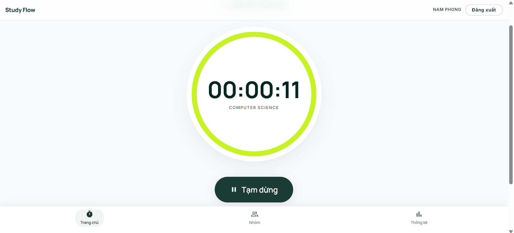
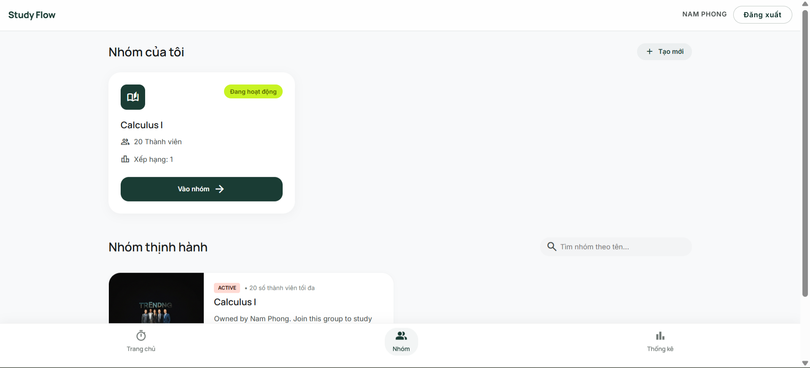
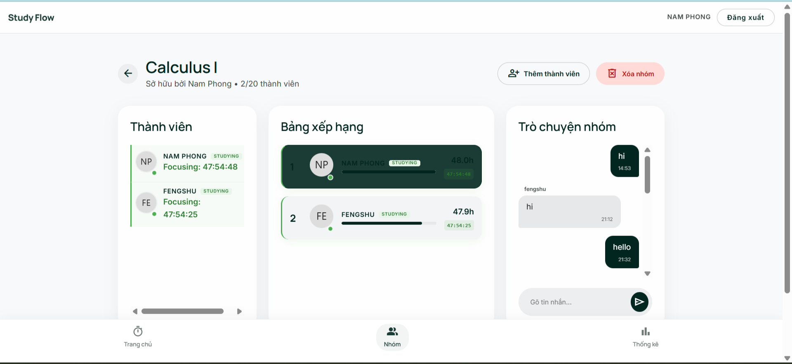
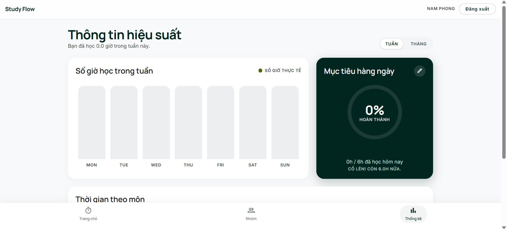
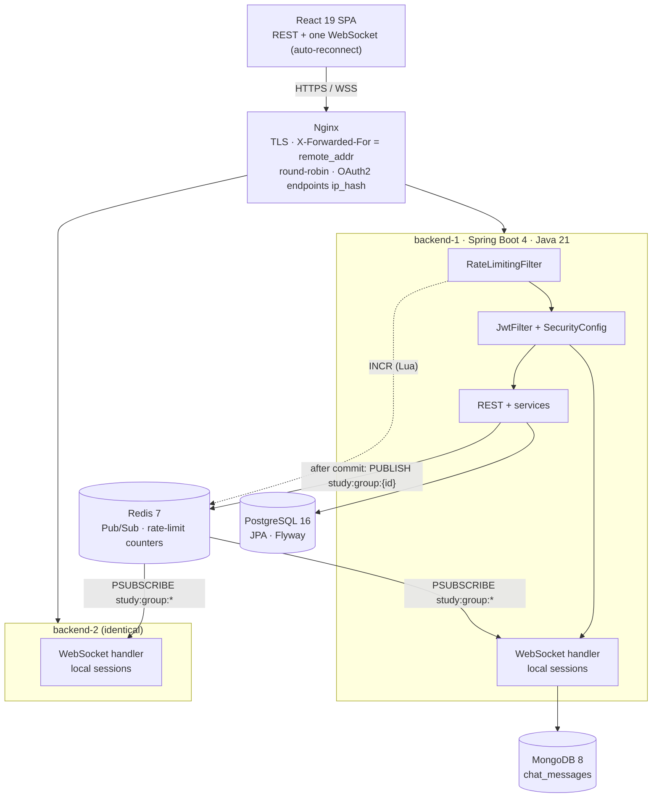
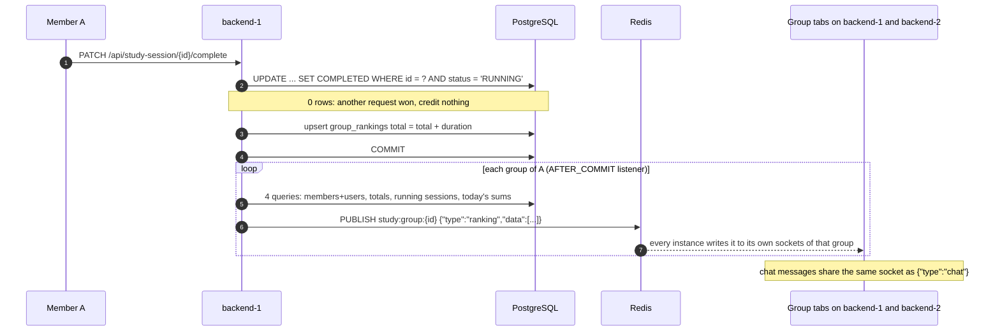

# Study App: focus together, rank together

A group study app. Each member runs a focus timer, the whole group sees a **live leaderboard** over WebSocket, and members chat in real time. Built as a Spring Boot monolith with a React SPA, and engineered for correctness: the ranking cannot be gamed from the client or by concurrent requests, it loads in a constant number of queries, and the backend scales out to several instances that share real-time state through Redis.

[](https://github.com/Phongasfd/study-app/actions/workflows/ci.yml)


---

## Highlights

| Problem | How it is solved |
| --- | --- |
| **The leaderboard ran 4N+1 queries** (61 for a 15-member group) and is recomputed on every timer start/stop | Rewritten as **4 queries regardless of group size**: a `join fetch` for members, projections, `IN (...)`, `SUM ... GROUP BY`, plus a composite index. Measured with Hibernate statistics on real PostgreSQL, and locked in by a test. |
| **Users could inflate their study time** | Start and end times come from the **server clock** (client-sent times are ignored). Only the owner can complete a session. Completion is **idempotent**. Sessions are capped at 12 hours, so a forgotten timer can't add days. |
| **Two requests at the same moment counted the time twice** (double click, two tabs) | "Load, check `RUNNING`, save" let both requests pass the check. Now the **database picks the winner**: a conditional `UPDATE ... WHERE status = 'RUNNING'` (row lock, the loser matches 0 rows), an atomic `INSERT ... ON CONFLICT DO UPDATE` for the ranking total, and a **partial unique index** allowing one `RUNNING` session per user, so concurrent starts converge on one session. Proven with 8 threads on real PostgreSQL: the old logic credited **14,400 s for a 1,800 s session**. |
| **The backend could only run as one instance** (WebSocket sessions and rate-limit buckets lived in JVM memory) | Events go through **Redis Pub/Sub**, so a member on instance A sees a timer started on instance B. Rate limiting uses a shared **Redis counter** (atomic Lua script), so N instances don't allow N x the limit. Nginx balances two instances; deploys roll one instance at a time and clients reconnect with backoff. Redis going down does not take the API with it: instances start without it and subscribe once it is back, and every Redis call fails fast. Tested with two in-process nodes on a real Redis server. |
| **Real-time without impersonation** | The WebSocket handshake is authenticated by the same JWT cookie as REST. Only group members can connect or post, and membership is re-checked on every message. The origin allow-list blocks cross-site WebSocket hijacking. |
| **Schema changes were applied by Hibernate at startup** (`ddl-auto: update`) | **Flyway** versioned migrations. The existing production database is *baselined* at V1, so V1 never re-runs there and only new migrations apply. Production runs `ddl-auto: validate`. Both paths are tested on an embedded PostgreSQL 16. |
| **Abuse** | Deny-by-default Spring Security. Rate limiting per client IP (Redis, or Bucket4j on a single instance); Nginx overwrites `X-Forwarded-For` so the IP can't be spoofed. CSRF via cookie token. Refresh-token rotation. |

## Screenshots

| Focus timer | Study groups |
| --- | --- |
|  |  |
| **Live chat and leaderboard** | **Statistics** |
|  |  |

More: [sign-in page](docs/images/auth-page.png) · [deployment](docs/images/deploy.png) · [ERD (PDF)](erd/study-app.pdf)

## Architecture



`app.redis.enabled=false` (the default) runs the same code as a single instance, with in-memory delivery and Bucket4j buckets ([ScalingConfig](backend/src/main/java/com/namphong/backend/config/ScalingConfig.java)).

## Features

- **Accounts:** e-mail and password (BCrypt) or Google OAuth2. Short-lived JWT in an `httpOnly` cookie; refresh-token rotation.
- **Focus timer:** start and stop study sessions, tag them with subjects, and see a daily base time.
- **Statistics:** weekly and monthly study time, broken down by subject.
- **Groups:** create, search, discover random groups, join (with a capacity limit); the owner adds or removes members, renames or deletes the group.
- **Live leaderboard:** total time (completed plus the running session) and who is studying now. Ties share a rank. Pushed to every open tab on each start or stop.
- **Group chat:** real-time over WebSocket and persisted in MongoDB; history loads on open.
- **i18n:** Vietnamese and English.

## How it works

### Live leaderboard: one WebSocket, two message types



The board is pushed only **after commit**, so a rolled-back request (for example the losing side of two concurrent starts) never shows up on anyone's screen.

### Concurrency: why the database decides

| Race | Before | After |
| --- | --- | --- |
| Two `complete` calls for one session | both read `RUNNING`, both add the duration | `UPDATE ... WHERE status = 'RUNNING'`: PostgreSQL row-locks the row, the second statement re-checks the condition after the first commits and matches nothing |
| Two transactions add to the same `(group, user)` ranking row | read total in Java, add, save: one increment lost; two first-time inserts collide on the unique key | `INSERT ... ON CONFLICT (group_id, user_id) DO UPDATE SET total_duration = total_duration + excluded.total_duration` |
| Two `start` calls at once | both see no running session, both insert one; the overlap is later counted twice | partial unique index `(user_id) WHERE status = 'RUNNING'` (V3): the slower insert fails and that request returns the faster one's session |

A check in Java can't close these gaps, because both requests run the check before either commits. `StudySessionConcurrencyTest` fires 8 threads at once against embedded PostgreSQL 16.

### Why the ranking query count is constant

| Group size | Before | After |
| --- | --- | --- |
| 3 members | 13 statements | 4 |
| 15 members | 61 statements | 4 |

Before, each member cost 3 queries plus one EAGER `@ManyToOne` user load. Now the board loads with 4 batched queries:

1. members with their users (`join fetch`)
2. ranking totals (interface projection)
3. RUNNING sessions (`WHERE user_id IN (...)`)
4. today's completed seconds (`SUM ... GROUP BY user_id`)

An index on `study_sessions (user_id, status, start_time)` serves queries 3 and 4. See `GroupRankingQueryCountTest`.

## Tech stack

| Layer | Technology |
| --- | --- |
| Backend | Java 21, Spring Boot 4, Spring MVC, Spring WebSocket, Spring Data JPA, Spring Data MongoDB |
| Security | Spring Security (deny by default), OAuth2 client (Google), JJWT 0.12, cookie CSRF, Bucket4j |
| Data | PostgreSQL 16 with Flyway migrations, MongoDB 8 for chat, Redis 7 for Pub/Sub and rate limits |
| Frontend | React 19, Vite, React Router 7, Axios, i18next |
| Testing | JUnit 5, Mockito, MockMvc, embedded PostgreSQL 16 (zonky) and embedded Redis (no Docker), Hibernate statistics |
| Delivery | Docker, Docker Compose, Nginx, GitHub Actions (Buildx with layer cache, SHA-tagged images), Docker Hub, AWS EC2 |

## Design decisions and trade-offs

| Decision | Why | Trade-off / alternative |
| --- | --- | --- |
| One WebSocket for chat and ranking | One connection per tab; a typed envelope (`type`) | Raw WebSocket instead of STOMP: less tooling, simpler protocol |
| Redis Pub/Sub fan-out, one pattern subscription per instance | Any instance can serve any group's socket, so nginx needs no sticky sessions for WebSockets. The ranking is computed once, on the instance that handled the change, and forwarded as-is | Pub/Sub is fire-and-forget: an instance reconnecting to Redis misses events (clients reload history on reconnect, the next push corrects the board). Every instance receives every group's events; per-group `SUBSCRIBE` or Redis Streams would be the next step |
| Fixed-window rate limit in Redis (Lua `INCR` + `PEXPIRE`) | One atomic round trip, shared by all instances | Up to 2x the limit across a window boundary (a sliding window or GCRA script removes it). **Fails open** at once if Redis is down: Lettuce rejects commands while disconnected and waits at most 500 ms otherwise. With the 60 s default every request of the API waited a minute during a Redis outage |
| One dispatcher thread per instance for Redis messages | Spring's default listener executor starts a thread per message, which delivered back-to-back chat messages out of order (caught by a test: `0, 2, 1, ...`) | One slow client could stall the thread, so every socket is wrapped in `ConcurrentWebSocketSessionDecorator` (5 s send limit, 512 KB buffer). The decorator only flags a socket over its limits, so the registry closes and drops it, and the client reconnects |
| Redis down while publishing | Deliver to this instance's sockets only | Degrades to single-instance behaviour instead of dropping the event for everyone |
| Redis down at startup | The Pub/Sub subscription is started on a background thread once Redis answers, not by the application context (which aborted startup, a crash loop under `restart: always`) | Until Redis is back, this node only reaches its own sockets |
| Ranking read on one background thread after commit | Reading it in the after-commit callback needed a second DB connection per request while the first was still held: 10 simultaneous starts deadlocked the default pool of 10 and every push was lost | The push leaves a few milliseconds later; one thread keeps the pushes in commit order |
| OAuth2 endpoints pinned with `ip_hash` | Spring keeps the authorization request in the HTTP session of the instance that started the login | The only sticky route. A cookie-based `AuthorizationRequestRepository` would remove it |
| Rolling deploy, one instance at a time | The other instance keeps serving | Migrations must stay compatible with the previous release (expand, then contract). No health endpoint yet, so the script waits a fixed 30 s |
| Totals stored in `group_rankings`, live time computed on read | Reads stay cheap; the running session needs no writes | At 10k+ members per group, move to a Redis sorted set (`ZINCRBY` / `ZREVRANGE`) |
| Chat in MongoDB | Append-heavy, read by group and time, no joins | Two databases to operate; PostgreSQL with `(group_id, created_at)` would also suffice at this scale |
| Baseline-on-migrate Flyway adoption | Moves an existing production schema to migrations without downtime or data loss | V1 must equal the Hibernate-generated schema; tests verify both paths |

## Testing

```bash
cd backend
./mvnw test     # 52 tests; embedded PostgreSQL 16 and Redis start automatically, no Docker
```

| Suite | What it proves |
| --- | --- |
| `StudySessionConcurrencyTest` | 8 simultaneous `complete` calls credit a session once (the old logic credited it 8 times); 8 simultaneous `start` calls leave exactly one `RUNNING` session; 8 concurrent ranking increments are all kept; one ranking push per commit and none for rolled-back requests |
| `RankingBroadcastPoolTest` | 12 members press start at once on a pool of 4 connections: all 12 pushes arrive and nothing stalls (the previous code deadlocked the pool and lost the pushes) |
| `MultiInstanceRealtimeTest` | Two nodes on one real Redis: a chat sent on node A reaches members on both nodes exactly once and in order (200 messages), other groups get nothing, and without Redis node B never sees it. The rate limit is shared across nodes (in-memory buckets would allow 2x). With Redis down, events still reach local sockets and requests aren't blocked. Redis down at startup: the app starts and subscribes once Redis is up. Redis dying at runtime: the limiter fails open in well under 2 s. `app.redis.enabled` wires the right beans, and an unrecognised value falls back to one instance instead of failing to start |
| `GroupSessionRegistryTest` | A client that stops reading is closed and dropped, so it reconnects instead of staying connected and receiving nothing |
| `GroupRankingQueryCountTest` | Same statement count for 3 and 15 members (4 or fewer); totals, ranks and "studying" flags are correct |
| `SchemaMigrationTest` | A fresh DB migrates V1 to V3 and validates. A DB created by `ddl-auto: update` is baselined, only V2 and V3 run, and it validates. V3 closes existing duplicate `RUNNING` sessions so its unique index can be built |
| `StudySessionServiceTest` | Server time only, owner-only completion, idempotent completion, a lost race credits nothing, 12h cap, credit on auto-close |
| `ChatWebSocketHandlerTest` | Rejects unauthenticated users and non-members, ignores a spoofed `userId`, stops a user who left the group |
| `RateLimitingFilterTest` | 429 after the limit; a spoofed `X-Forwarded-For` doesn't reset the bucket |

The suite also covers `UserService`, `RefreshTokenService`, `JwtService`, `UserController` and the global exception handler. CI runs it on every push and pull request.

## Getting started

**Prerequisites:** JDK 21, Node.js 20, Docker.

1. Start the databases (PostgreSQL on `5433`, MongoDB on `27017`, Redis on `6379`, which only the two-instance setup below uses). Credentials go in a root `.env`: `POSTGRES_USER`, `POSTGRES_PASSWORD`, `POSTGRES_DB`, `MONGO_INITDB_ROOT_USERNAME`, `MONGO_INITDB_ROOT_PASSWORD`.
   ```bash
   docker compose -f docker-compose.dev.yml up -d
   ```
2. Create `backend/src/main/resources/application.yml` (git-ignored):
   ```yaml
   spring:
     datasource:
       url: jdbc:postgresql://localhost:5433/studyapp
       username: <POSTGRES_USER>
       password: <POSTGRES_PASSWORD>
     data:
       mongodb:
         uri: mongodb://<user>:<password>@localhost:27017/study_app_chat?authSource=admin
     jpa:
       hibernate:
         ddl-auto: validate          # Flyway owns the schema
     security:
       oauth2:
         client:
           registration:
             google:
               client-id: <GOOGLE_CLIENT_ID>
               client-secret: <GOOGLE_CLIENT_SECRET>
               redirect-uri: "{baseUrl}/api/login/oauth2/code/{registrationId}"
               scope: [profile, email]
   jwt:
     secret: <base64 key, e.g. openssl rand -base64 32>
   app:
     oauth2:
       redirect-uri: http://localhost:5173
     cookie:
       secure: false
     cors:
       allowed-origins: http://localhost:5173
   ```
3. Run the backend on `http://localhost:8080`. Flyway creates the schema on first start.
   ```bash
   cd backend && ./mvnw spring-boot:run
   ```
4. Run the frontend on `http://localhost:5173`:
   ```bash
   cd frontend && npm ci && VITE_API_BASE_URL=http://localhost:8080/api npm run dev
   ```

### Run two instances locally

See the cross-instance fan-out with your own eyes: two backends, each with its own frontend.

1. In `application.yml`, allow both frontends: `app.cors.allowed-origins: http://localhost:5173,http://localhost:5174`.
2. Build once and start two backends with Redis enabled:
   ```bash
   cd backend && ./mvnw -DskipTests package
   java -jar target/demo-0.0.1-SNAPSHOT.jar --app.redis.enabled=true --server.port=8080
   java -jar target/demo-0.0.1-SNAPSHOT.jar --app.redis.enabled=true --server.port=8081   # second terminal
   ```
3. Start one frontend per backend:
   ```bash
   cd frontend
   VITE_API_BASE_URL=http://localhost:8080/api npm run dev -- --port 5173
   VITE_API_BASE_URL=http://localhost:8081/api npm run dev -- --port 5174   # second terminal
   ```
4. Sign in with e-mail and password (cookies on `localhost` are shared across ports), open the same group on `:5173` and `:5174`, and start the timer or send a chat message on one: the other updates live. Restart the backends without `--app.redis.enabled=true` and it no longer does.

## Project structure

```
backend/src/main/java/com/namphong/backend/
  controller/   REST endpoints (sessions, groups, ranking, chat, stats, auth)
  service/      business logic (StudySessionService, GroupRankingService, ...)
  websocket/    ChatWebSocketHandler, GroupSessionRegistry (this node's sockets),
                GroupEventBus (local or Redis Pub/Sub), RankingBroadcaster (after commit),
                RedisSubscriptionStarter (subscribes once Redis answers)
  security/     JwtFilter, SecurityConfig, OAuth2 success handler
  config/       ScalingConfig (single vs multi-instance), rate limiters, WebSocket, Flyway
  repository/   Spring Data (batched projections, conditional update, atomic upsert)
backend/src/main/resources/db/migration/   V1 baseline, V2 index, V3 one running session per user
frontend/src/   pages, timer context, i18n (vi, en)
```

## Roadmap

- A health endpoint (Actuator) so the rolling deploy waits for "ready" instead of a fixed delay.
- Cookie-based OAuth2 authorization requests, to drop the last sticky route.
- Redis Streams instead of Pub/Sub if missed events ever matter more than a reload on reconnect.
- Observability with Micrometer, Prometheus and OpenTelemetry.
